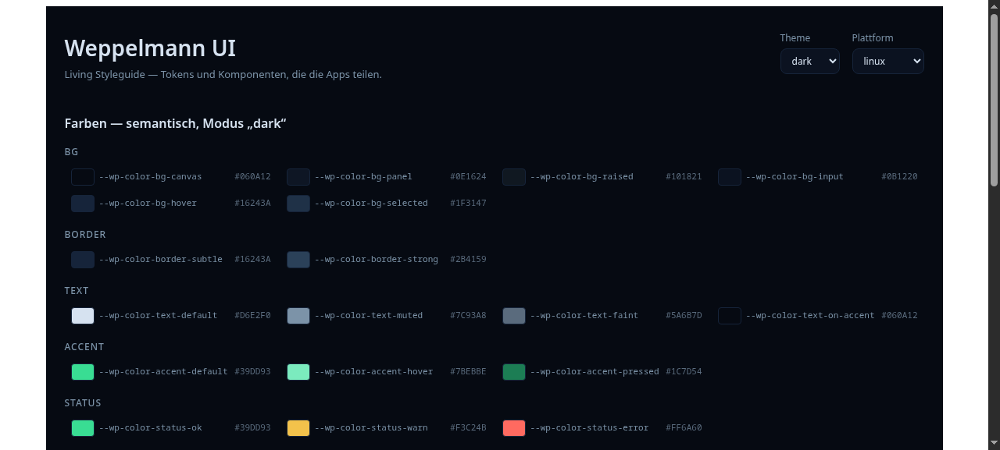
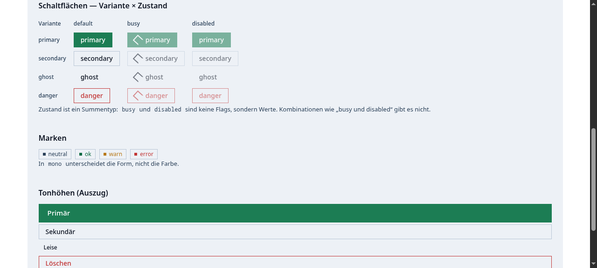
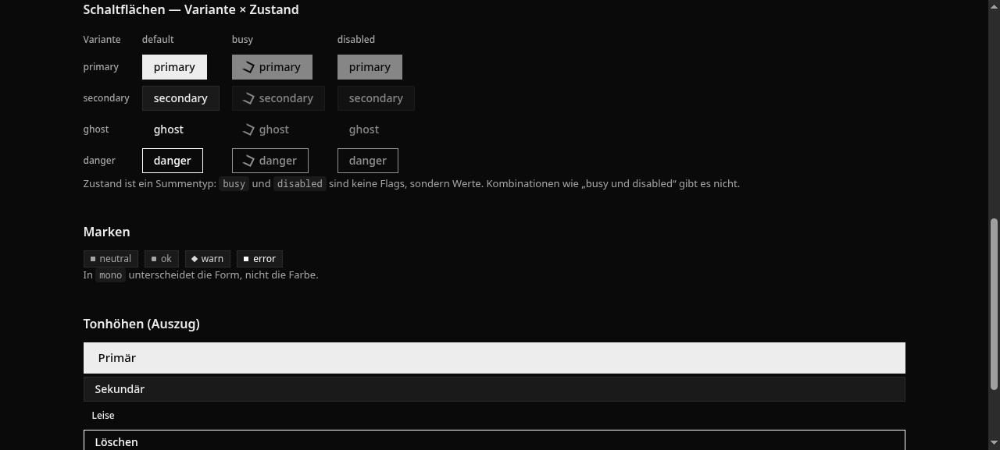

# weppelmann-ui

Ein UI-Baukasten für die Weppelmann-Apps: geteilte Komponenten, drei Themes,
ein Living Styleguide. Vue 3 + TypeScript, ausgeliefert über Tauri.

| Paket | Inhalt |
|---|---|
| `@weppelmann/tokens` | Design-Tokens nach W3C DTCG, Compiler nach CSS/JSON |
| `@weppelmann/components` | Vue-3-Komponenten (in Arbeit) |
| `@weppelmann/icons` | Symbole und App-Icons (in Arbeit) |
| `@weppelmann/testkit` | Playwright-Fixtures, axe-Setup, Mock-Backend (in Arbeit) |
| `styleguide` | Living Styleguide, rendert Tokens und Komponenten |

Verbindlich: [PLAN.md](PLAN.md) und [AGENTS.md](AGENTS.md).

## Der Styleguide





Der Styleguide zeigt Farben **je Modus**, die Maße (Abstand, Radius, Größe,
Schrift, Dauer) mit Vorschau und die **Kontrastprüfung** aller verwendeten
Farbpaare — mit Verhältnis und Stufe (AA/AAA), Verstöße rot.

Derselbe Katalog in `mono` — Statusfarben werden über die Form unterschieden:



## Loslegen

```bash
npm install
npm run tokens      # Tokens bauen -> packages/tokens/dist
npm run dev         # Styleguide unter http://localhost:5173
```

## Prüfen

```bash
npm test        # Tokens gültig · Kontrast nach WCAG 2.2 · Typprüfung des Styleguides
npm run kontrast # nur die Kontrasttabelle (Rückgabe 1 bei einem neuen Verstoß)
npm run build   # Tokens bauen und Styleguide bauen
```

`npm test` prüft drei Dinge: die Tokens bauen ohne Abweichung zwischen den
Modi (`--check`), **jedes** verwendete Farbpaar erreicht seine Schwelle
(Text 4,5:1, Rahmen 3:1), und der Styleguide typprüft. Bekannte Abweichungen
stehen mit Begründung in `packages/tokens/scripts/kontrast.mjs`; ein **neuer**
Verstoß lässt den Lauf scheitern.

**Noch nicht vorhanden:** Tests der Komponenten selbst (`packages/components`
hat kein Vitest) und die Frontend-Prüfung mit Playwright/axe aus
[PLAN.md](PLAN.md) E6 — `packages/testkit` fehlt noch. Bis dahin ist der
Kontrastlauf die einzige automatische Barrierefreiheits-Prüfung.

## Themes

Genau drei: `dark` (Standard), `light`, `mono`. Umschaltung über
`data-theme` am Wurzelelement. Keine weiteren Themes, kein Runtime-Editor.

## Lizenz

GPL-3.0-or-later. Siehe [LICENSE](LICENSE).
